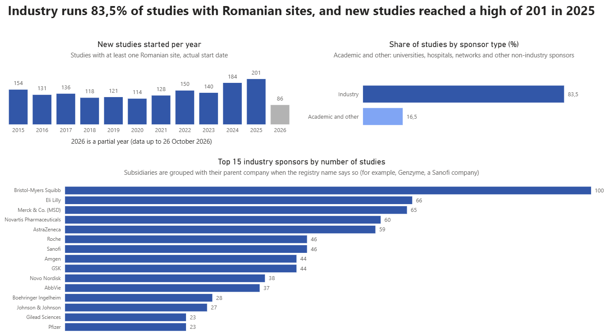
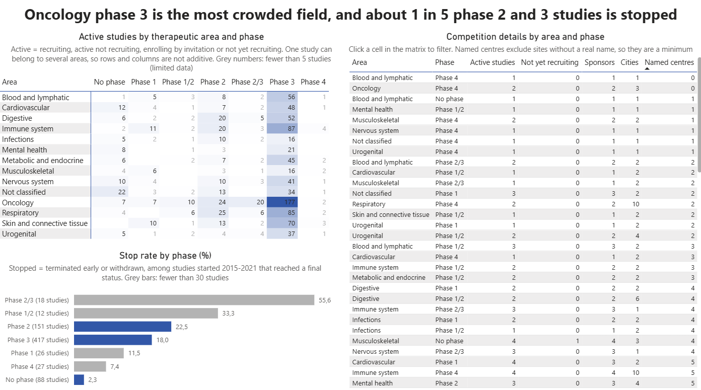
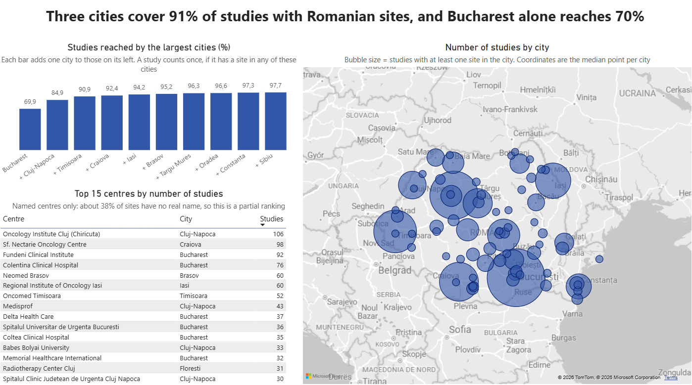

# Romania Clinical Trials Feasibility Explorer

> **Status: v1 (target date 2026-11-20).** Data extracted and cleaned, SQL analyses written, Power BI dashboard with three pages built. Final checks and documentation are in progress. See the roadmap below.

## Problem statement

When a sponsor considers running a clinical trial in Romania, a feasibility manager needs a quick, evidence-based view of the existing trial landscape: which therapeutic areas and phases are active, which sponsors and cities are involved, how many studies compete for the same patients, and how often studies stop. Public registry data contains this information, but it is nested, inconsistent and hard to explore directly.

This project builds a cleaned dataset and an interactive dashboard of studies with at least one site in Romania (2015 to present), and explores two questions:

1. Does Romania's participation in clinical trials match the size of its population? (needs population data and other countries, planned for v2)
2. Are trials concentrated in a few large cities with university hospitals? (answered in v1, see the Sites page)

These are exploratory questions: the project describes patterns, it does not claim to explain why sponsors choose Romania.

The project is also a practical exercise in applying Python, pandas, SQL and Power BI to real, messy data.

## Reference scenario

> "I am planning a Phase 3 study in a given therapeutic area. In which cities can I find sites, how many competing studies are active in Romania, and which sponsors are already present?"

Every chart in v1 is meant to help answer this scenario. Choosing between countries needs other countries and is planned for v2. Target date for v1: 2026-11-20.

## Dashboard (Power BI)

The dashboard has three pages. The file is `powerbi/romania_clinical_trials.pbix`.

**Overview:** new studies per start year, industry versus academic sponsors, top 15 industry sponsors.



**Landscape:** active studies by therapeutic area and phase (with sponsors, cities and named centres per cell), and the stop rate by phase.



**Sites:** share of studies reached by the largest cities, a map of studies per city and the top 15 named centres.



## Key findings

All figures refer to interventional studies with at least one site in Romania and a start year of 2015 or later (1,717 studies; extract of 2026-10-26).

- **New studies per year:** between 114 and 154 a year from 2015 to 2023, then 184 in 2024 and 201 in 2025. 2026 (86 so far) is a partial year.
- **Sponsors:** industry sponsors run 83.5% of the studies (1,433 of 1,717). The top 15 industry sponsors account for about half of the industry studies; Bristol-Myers Squibb is first with 100 studies (subsidiaries included).
- **Competition:** oncology phase 3 is the most crowded field, with 177 active studies, 69 sponsors and 23 cities; the next area, the immune system, has 87.
- **Stop rate:** 18.0% for phase 3 (75 of 417 studies that reached a final status) and 22.5% for phase 2 (34 of 151). Phase 2/3 (55.6%) and phase 1/2 (33.3%) look higher but rest on only 18 and 12 studies.
- **Concentration:** Bucharest has a site in 69.9% of the studies; Bucharest, Cluj-Napoca and Timisoara together reach 90.9%, and the 10 largest cities 97.7%. The largest named centres are the Oncology Institute in Cluj (106 studies), the Sf. Nectarie Oncology Centre in Craiova (98) and the Fundeni Clinical Institute in Bucharest (92).

## Data source

**Source:** [ClinicalTrials.gov](https://clinicaltrials.gov), the public registry of clinical studies run by the U.S. National Library of Medicine. Official API page: https://clinicaltrials.gov/data-api/api

**Endpoint:** `https://clinicaltrials.gov/api/v2/studies` (API v2, no key required)

**Request parameters used:**

| Parameter | Value | Purpose |
|---|---|---|
| `query.locn` | `Romania` | Studies whose location fields contain "Romania" |
| `pageSize` | `1000` | Studies per page |
| `countTotal` | `true` | Return the total number of matching studies |
| `pageToken` | from `nextPageToken` | Move to the next page |

**How the endpoint and parameters were identified:** from community tutorials, then verified by testing the request (HTTP 200, response structure inspected) and by comparing the returned total with the number of studies retrieved.

**Extraction date:** 2026-10-26. The registry is updated continuously, so the total will change over time.

**Result:** 3,721 studies retrieved over 4 pages (`02_extract_data.ipynb`), saved as raw JSON (not stored in the repository). After restricting to studies with a start year of 2015 or later, 1,984 studies remain for analysis; 1,717 of them are interventional.

| Step | Studies |
|---|---|
| Retrieved from the API | 3,721 |
| At least one site in Romania | 3,720 |
| Start year 2015 or later | 1,984 |
| Interventional only | 1,717 |

Filters and the study table are built in `03_build_tables.ipynb`; the cleaned study table is saved as `data/clean/studies.csv`.

**Finding:** `query.locn` matches text, not the country of the site. One study (NCT00336544) matched only because "ROMANIA" appears in facility names located in the United States. Site-level analysis therefore filters on the `country` field. 3,720 studies have at least one site in Romania.

**Finding:** The date type (actual or estimated) is missing for some studies. A study without a date type is treated as started if its status is COMPLETED or TERMINATED (it must have started); the remaining 9 studies are labelled "unknown" and left out of the per-year chart. 45 studies have an estimated start date and are labelled "planned"; 23 of them have an estimated start year before 2026, which suggests records that were not updated. One interventional study has no phase field and is labelled "No phase".

**Finding:** 287 of the 1,717 interventional studies (about 17%) have no phase (the code `NA` in the registry, plus one study without a phase field). The most frequent intervention types among them are device (88 studies), behavioural (76), other (71), procedure (35) and dietary supplement (25); only 16 include a drug and 2 a biological product (a study can have several intervention types). These studies are kept in the table and in charts that do not depend on phase, and left out of phase charts; the 16 studies with a drug but no phase are therefore missing from the phase charts.

**Finding:** The `browseBranches` field of the registry's derived section is not present in the extract; therapeutic areas are built from the `meshes` and `ancestors` fields of `conditionBrowseModule`.

**Finding:** In the registry's sponsor class, `OTHER` (265 studies) is mostly universities, hospitals, foundations and medical societies, but also contains a few small companies and individual investigators. `NETWORK` (13 studies) is almost entirely one company (11 studies) and not a research network. The dashboard therefore shows `OTHER`, `NETWORK` and `OTHER_GOV` together as "Academic and other".

## Tools

Python (pandas), SQL (SQLite), Power BI

## Repository structure

```
data/raw/        placeholder; the raw API response (raw_studies.json) is not stored in the repository
data/clean/      cleaned tables: studies, study_area, sites, city_coords, sponsor_alias
data/powerbi/    results of the SQL queries, read by the dashboard
notebooks/       02 extraction, 03 studies, 04 therapeutic areas, 05 sites, 06 SQLite database,
                 07 SQL analyses, 08 export for Power BI
sql/             queries, each documented with the question it answers
powerbi/         Power BI file and screenshots of the three pages
docs/            requirements
```

Hand-made mappings (therapeutic areas, city names, facility aliases, sponsor aliases) are defined in notebooks 04, 05 and 06, so every cleaning choice can be read next to its code.

## Documentation

- [Requirements](docs/requirements.md): definitions (section 4), business questions (section 5) and limitations (section 7)
- Cleaning decisions are documented in the notebooks and summarised in the known limitations below

## Roadmap

- [x] Requirements and scope (v1)
- [x] Extract data from the API
- [x] Clean and model the data (pandas)
- [x] SQL analysis (table sizes and key totals checked against the pandas results)
- [x] Power BI dashboard (v1: landscape, sponsors, cities, competition, stop rate)
- [ ] Final checks and documentation
- [ ] v2: comparison with other countries and population-adjusted figures, study duration, termination reasons
- [ ] v3: simple recruitment projection and a one-page feasibility brief for a sample study

## Known limitations

- ClinicalTrials.gov does not contain every European trial (EU CTIS / EudraCT are separate registries).
- Enrolment figures refer to the whole study, not to Romania.
- Study status is global: "active" and "stopped" describe the whole study, not the Romanian sites. "Active" includes studies that are no longer recruiting but still running (ACTIVE_NOT_RECRUITING); studies not yet recruiting are included and counted separately.
- Stop rate: stopped studies (TERMINATED or WITHDRAWN) divided by studies with a final status (COMPLETED, TERMINATED, WITHDRAWN), for start years 2015-2021 only, because recent studies have not had time to stop. SUSPENDED (2 studies) and UNKNOWN (67) are left out. Groups with fewer than 30 studies (phases 1, 1/2, 2/3 and 4) are shown in grey and should be read with care.
- Start dates are text with different forms (for example `2008-06` and `2015-12-18`); the year is taken from the first four characters. Some studies have no start date, and the date type (actual or estimated) is missing for part of them. Studies with an estimated start date are kept apart from started studies.
- Expanded access programmes and observational studies are excluded; only interventional studies are analysed.
- Sponsors are grouped by the registry's `class` field. `OTHER` also contains a few small companies and individual investigators. Subsidiaries are grouped with their parent company only when the registry name says so (for example "Genzyme, a Sanofi company") in a hand-made alias table for the largest industry sponsors; other relations (for example Celgene and Bristol-Myers Squibb) are not merged. Sponsor names are kept as in the registry; a few are individual investigators and are not shown in the dashboard.
- City names are cleaned with a hand-made mapping (75 names, 21 site rows without a usable city). Facility names are unified with an automatic key plus a hand-made alias table for the largest centres only, so the number of centres (about 1,830) is approximate.
- About 38% of Romanian sites (2,841 of 7,524) have only a placeholder name in the registry (for example "Site 1901" or "Research Site") or no name. They are counted by city but not as centres, so centre rankings and the "named centres" counts are minimums.
- Practices named after a physician are shown as "Private practice" so that no personal names are stored; the dashboard's centre ranking leaves them out.
- A study can belong to several therapeutic areas and can have sites in several cities, so counts per area or per city cannot be added up. The cumulative share of the largest cities counts each study once.
- Therapeutic areas are grouped from the registry's MeSH terms with a hand-made mapping, so the grouping is approximate. 13 areas are used; about 16% of studies (268 of 1,717) are shown as "Not classified": 194 have no MeSH term (the registry did not match the condition text, for example because of typos or added qualifiers, or the entry is not a disease) and 74 have terms outside the listed areas (for example behavioural studies).
- The phase field is a list; a study with several phases gets one combined label (for example "Phase 1/2"). Studies without a phase are labelled "No phase".
- Registry coordinates are generated from the site text and are unreliable for some sites (142 missing, 34 far from their city). For example, 45 of the 61 sites in Florești that have coordinates were placed in Prahova instead of Cluj county. Site-level coordinates are therefore not used; the map works at city level with the median coordinates per city, and Florești is set manually to its position near Cluj.
- Contact fields (people's names, phone numbers, e-mails) are dropped before any table is saved.
- Costs, approval timelines and patient availability cannot be measured with this data.
- The current year is incomplete and is labelled as partial.

## How to run

Requirements: Python 3 with `pandas` and Jupyter. SQLite is part of Python. Power BI Desktop is needed to open the dashboard.

1. Run the notebooks in `notebooks/` in this order (always from inside that folder, the paths are relative):
   - `02_extract_data.ipynb`: downloads the studies from the API and saves `raw_studies.json` in the notebooks folder. The registry changes over time, so the numbers can differ from the extract of 2026-10-26.
   - `03_build_tables.ipynb`, `04_build_areas.ipynb`, `05_build_sites.ipynb`: build the cleaned tables in `data/clean/`.
   - `06_load_sqlite.ipynb`: loads the tables into the SQLite database `data/clean/trials.db` (created locally, not stored in the repository).
   - `07_sql_analyses.ipynb`: runs the queries and shows the results.
   - `08_export_for_powerbi.ipynb`: runs the files in `sql/` and saves the results in `data/powerbi/`.
2. Without the API: the cleaned tables in `data/clean/` are in the repository, so you can start at `06_load_sqlite.ipynb`.
3. Open `powerbi/romania_clinical_trials.pbix`. The file already contains the loaded data. To refresh it from your own copy of the repository, change the data source paths (Transform data, Data source settings) to the CSV files in `data/powerbi/` and `data/clean/city_coords.csv`. The numbers use a point as decimal separator: in Power BI set the import locale to English (United States) (File, Options, Current file, Regional settings).
